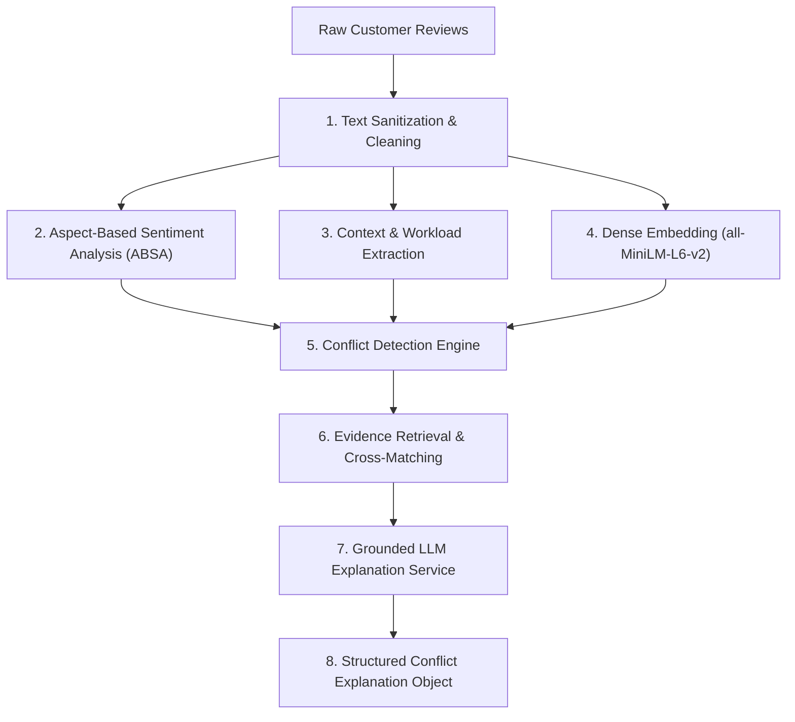

# AI Processing Pipeline: Review Conflict Resolver

## 1. High-Level Pipeline Workflow

The AI Pipeline is the core intelligence engine of Review Conflict Resolver. It transforms unstructured customer reviews into structured semantic representations, identifies contradictory opinions on identical product dimensions, retrieves supporting evidence, and synthesizes grounded explanations using external Large Language Models (LLMs).

---

## 2. Stage-by-Stage Implementation

### Stage 1: Text Sanitization & Preprocessing
- **Duplicate & Near-Duplicate Removal**: Removes exact duplicate strings and MinHash/Jaccard near-duplicates to prevent spam manipulation.
- **Language Detection**: Filters out non-target languages to maintain consistency.
- **Text Normalization**: Strips HTML artefacts, decodes unicode, handles emoji sentiment markers, and splits reviews into individual sentences using spaCy sentence boundary detection.

### Stage 2: Aspect-Based Sentiment Analysis (ABSA)
Rather than scoring an entire review with a single sentiment, the ABSA engine segments sentences and assigns polarities to specific product features.
- **Domain Aspect Taxonomy (Laptops)**:
  - `battery`: battery life, charging speed, charger weight, standby drain.
  - `performance`: speed, multitasking, boot time, lag, frame drops, rendering speed.
  - `thermals_and_noise`: fan noise, heating, temperature, throttle, lap comfort.
  - `display`: brightness (nits), color accuracy, viewing angles, glare, refresh rate, resolution (4K vs FHD).
  - `build_quality`: hinge durability, chassis flex, chassis material, weight, port durability.
  - `keyboard_and_trackpad`: key travel, backlight, trackpad size, click feel.
  - `audio_and_webcam`: speaker loudness, bass, microphone clarity, webcam noise.
  - `value_for_money`: pricing vs specs, durability longevity, repairability.
- **Sentiment Classification**: Rule-assisted lexical scoring with VADER / Transformer polarity models mapping each aspect occurrence to `positive`, `negative`, or `neutral` with confidence scores and exact span indices.

### Stage 3: Context & Workload Extraction
Extracts key contextual dimensions:
- **Usage Intensity**: `Low` (web browsing, typing, streaming), `Medium` (multitasking, spreadsheet models, basic photo editing), `High` (triple-A gaming, 4K video rendering, ML training, CAD).
- **Product Variant Attributes**: Explicit mentions of RAM (8GB, 16GB, 32GB), CPU (Intel Core i5/i7/i9, AMD Ryzen 5/7/9, Apple M-series), Display (FHD 60Hz, 4K OLED, 144Hz IPS), GPU (Integrated Iris/Radeon vs Dedicated RTX 4060/4070).
- **Environmental & Benchmark Conditions**: Ambient room temperature (hot tropics vs AC office), portability/lap usage, and baseline expectation (upgrading from an old machine vs transitioning from MacBook Pro).
- **Certainty Labeling**: Categorizes extracted context as `explicit` (directly stated by reviewer), `inferred` (heuristic estimation), or `unknown`.

### Stage 4: Dense Vector Embeddings
- Generates 384-dimensional dense semantic vectors using `sentence-transformers/all-MiniLM-L6-v2`.
- Embeddings are computed for:
  1. Entire review texts (for holistic semantic similarity).
  2. Aspect-evidence snippets (for fine-grained cluster alignment).
- Stored and indexed in PostgreSQL via `pgvector` for sub-50ms cosine similarity queries.

### Stage 5: Conflict Detection Engine
Detects true conflicting opinions:
1. **Aspect Alignment Constraint**: Opinions must address the **same aspect**. Comparing "Fast CPU" with "Bad Battery" is NOT a conflict.
2. **Polarity Disparity**: A conflict requires a substantial cluster of `positive` aspect ratings clashing with a cluster of `negative` aspect ratings.
3. **Conflict Score Formulation**:
   $$ConflictScore = \frac{2 \times \min(N_{pos}, N_{neg})}{N_{pos} + N_{neg}} \times \left(1 - \frac{1}{\sqrt{N_{total}}}\right)$$
   Where:
   - $N_{pos}$ = number of positive reviews on aspect $A$
   - $N_{neg}$ = number of negative reviews on aspect $A$
   - Score ranges from $0.0$ to $1.0$, penalized if total sample size is too small.

### Stage 6: Evidence Retrieval & Context Cross-Correlation
- Pulls high-confidence positive and negative evidence sentences.
- Cross-tabulates context features against polarity:
  - If 85% of negative battery reviews have `usage_intensity = High` or `display = 4K OLED`, while 90% of positive battery reviews have `usage_intensity = Low` and `display = FHD`, a strong contextual divergence is flagged.

### Stage 7: Grounded LLM Explanation Generation
- Utilizes Google Gemini (default) or OpenAI (fallback).
- Uses rigorous Prompt Engineering with **Zero-Hallucination Guardrails**:
  - The model is instructed to act as a Forensic Product Intelligence Investigator.
  - Provided with strict factual inputs: product details, conflicting polarities, context breakdown table, and verbatim review excerpts.
  - Must return structured JSON output matching Pydantic schemas.
  - **Golden Directive**: *"If the contextual data does not conclusively explain the divergence, explicitly declare: 'Available evidence is insufficient to explain the conflict with certainty.'"*
