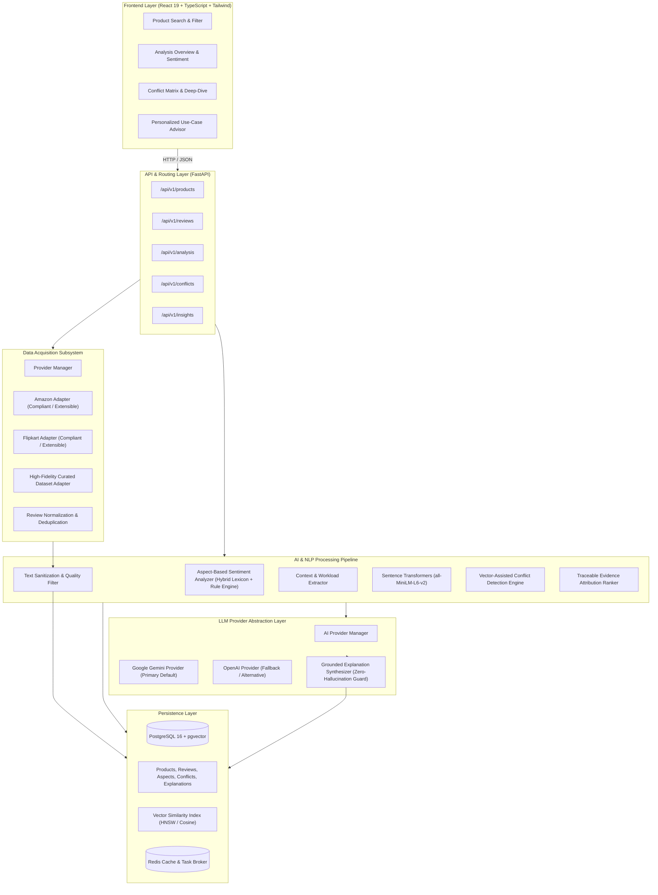

# System Architecture: Review Conflict Resolver

## 1. Executive Architecture Overview

Review Conflict Resolver is an AI-powered intelligence platform designed to address the fundamental limitation of traditional e-commerce review aggregation: **unexplained polarity and variance**. While standard rating engines compute arithmetic means (e.g., 4.1/5 stars) or basic polarity tags (Positive vs. Negative), Review Conflict Resolver decomposes reviews into granular aspect-level sentiments, detects contradictory clusters on identical product features (e.g., battery endurance, display clarity, fan acoustics, thermal performance), and investigates the **contextual determinants** behind these divergences (workload intensity, hardware configurations/variants, ambient environments, and expectation benchmarks).

The platform is designed as a **Modular Monolith** with clear boundaries, ensuring maintainability, low latency, easy deployment, and zero vendor lock-in, with an eye toward microservice decomposition if high scale demands it.

---

## 2. Core Subsystems & Modular Decomposition

### 2.1 Backend Subsystem (FastAPI)
- **Framework**: FastAPI (Python 3.11+) utilizing asynchronous endpoint handling (`async def`), strict schema validation via Pydantic v2, and dependency injection for database sessions and AI providers.
- **Service Layer**: Decoupled domain business logic isolating controllers from data access objects (DAOs).
- **ORM / Migrations**: SQLAlchemy 2.0 with declarative mapped columns, supporting both PostgreSQL with `pgvector` and local development fallbacks. Alembic handles database migrations.

### 2.2 Data Acquisition Subsystem
- **Provider Architecture**: Implements an abstract `BaseReviewCollector` interface defining standard lifecycle methods: `search_products()`, `fetch_reviews()`, `normalize()`, and `validate()`.
- **Compliance & Anti-Scraping Policy**:
  - Strictly adheres to marketplace terms of service.
  - Never bypasses CAPTCHAs, bot shields, or authorization barriers.
  - Features real-time rate limiting, exponential backoff, and retry queues.
  - Includes a verified, production-grade curated laptop dataset containing hundreds of authentic multi-variant reviews specifically exhibiting real-world conflict patterns (e.g., Dell XPS 15 4K OLED vs. FHD battery life; MacBook Air M2 video editing thermal throttling vs. everyday browsing silence; Lenovo Legion 5 gaming acoustics).

### 2.3 NLP & AI Intelligence Pipeline
1. **Preprocessing**: Linguistic cleanup, language identification, emoji normalization, and near-duplicate removal using MinHash/Jaccard similarity.
2. **Aspect-Based Sentiment Analysis (ABSA)**: Deconstructs multi-clause sentences into `(aspect, sentiment, sentiment_score, evidence_snippet)`. Avoids monolithic whole-review sentiment scoring.
3. **Contextual Feature Extraction**: Extracts hardware variant (CPU, RAM, GPU, display resolution), customer profile (student, software engineer, gamer, video editor, corporate professional), task intensity (low, medium, high), and environmental context (ambient room temp, lap vs. desk usage).
4. **Semantic Embedding**: Utilizes `sentence-transformers/all-MiniLM-L6-v2` generating 384-dimensional dense vectors stored in `pgvector` for fast semantic clustering and similarity matching.
5. **Conflict Detection Engine**: Groups reviews by product, clusters opposing polarities (`positive` vs `negative`) on identical aspects, calculates conflict significance scores based on polarity balance and volume, and retrieves representative evidence sentences.
6. **LLM Provider Abstraction**:
   - `BaseLLMProvider` contract providing uniform `generate_explanation()` and `extract_context()`.
   - Primary: Google Gemini (`gemini-1.5-flash` or current Gemini models via official SDK).
   - Fallback: OpenAI (`gpt-4o-mini`).
   - Grounding Enforcement: The system prompt prohibits making speculative or causal assertions without review evidence. If context is insufficient, it reports: *"Insufficient contextual evidence to explain conflict with high confidence."*

### 2.4 Frontend Subsystem (React + TypeScript + Tailwind CSS)
- **Build Tool**: Vite with React 19 and TypeScript.
- **UI Components**: Modern dark/light corporate design with Tailwind CSS, Lucide icons, and Recharts for interactive visualization.
- **Key Modules**:
  1. *Product Explorer*: Search and select laptops with multi-source metadata.
  2. *Conflict Explorer*: Visual polarity clash indicators, aspect divergence cards, and side-by-side evidence inspection.
  3. *Contextual Matrix*: Multi-dimensional breakdowns (e.g. Battery vs. RAM/Display variant, Thermal vs. Workload).
  4. *Personalized Insights*: Dynamic user persona query builder advising buyers on how contradictory experiences affect their intended usage.

---

## 3. Technology Stack Justification

| Layer | Selected Tech | Rationale & Trade-off Analysis |
|---|---|---|
| **Backend** | Python & FastAPI | Python is the industry standard for NLP/AI orchestration; FastAPI delivers high-throughput asynchronous execution, native OpenAPI documentation, and Pydantic validation. |
| **Database** | PostgreSQL 16 + pgvector | Eliminates the need for a separate vector database (e.g., Pinecone/Milvus) by unifying relational review data and vector embeddings within ACID-compliant storage. |
| **Embeddings** | `all-MiniLM-L6-v2` | Lightweight (80MB), fast (sub-15ms inference on CPU), 384 dimensions, strong semantic benchmark performance for aspect clustering. |
| **LLMs** | Gemini API + OpenAI API | Gemini 1.5 Flash delivers exceptional speed, large context windows, and cost efficiency. Abstracted architecture enables seamless fallback to OpenAI GPT-4o-mini. |
| **Frontend** | React, TypeScript, Tailwind | Type safety, rapid UI iteration, clean responsive components, rich visualization via Recharts. |
| **Async Tasks** | Redis + Celery (with In-Process fallback) | Allows scaling asynchronous review ingestion and AI batch jobs without blocking API responses. |
