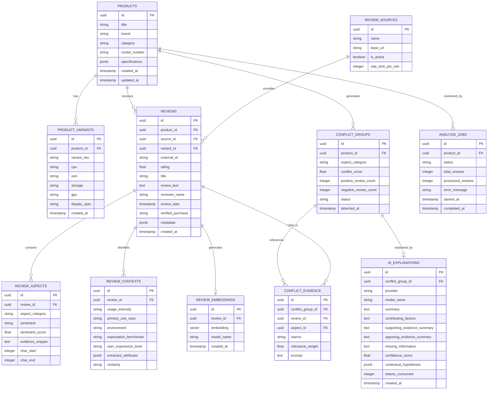

# Database Design: Review Conflict Resolver

## 1. Relational Architecture & Entity-Relationship Model

The Review Conflict Resolver database is designed with third normal form (3NF) principles, balanced with performance-optimized indexing and vector storage via `pgvector`.



---

## 2. Table Specifications and DDL

### 2.1 Products & Variants
- `products`: Master record of product entities. Category default is `laptops` with extensible structure for `smartphones`, `headphones`, etc.
- `product_variants`: Normalized hardware and configuration variations (e.g. 16GB RAM vs 32GB RAM, OLED vs IPS screen).

### 2.2 Ingestion & Reviews
- `review_sources`: Catalog of allowed e-commerce sources (Amazon, Flipkart, Curated Dataset) with compliance settings.
- `reviews`: Immutable raw review text and external attributes. Raw reviews are **never mutated** by AI processes.

### 2.3 NLP & Granular Analysis
- `review_aspects`: Granular aspect extractions (`battery`, `thermals`, `display`, `build_quality`, `performance`, `keyboard`, `speakers`, `value_for_money`).
- `review_contexts`: Customer workload profiles, primary task domain (`gaming`, `coding`, `office_work`, `content_creation`, `casual`), environment (`air_conditioned`, `outdoor`, `high_ambient`), and benchmark expectations.
- `review_embeddings`: Dense vector representations (384-d vector) with cosine similarity indexes.

### 2.4 Conflict Resolution & Explanations
- `conflict_groups`: Discovered polarities clustered on the same aspect for the same product.
- `conflict_evidence`: Many-to-many traceable links between detected conflicts and specific review sentences.
- `ai_explanations`: Structured LLM-synthesized resolution reports, strictly grounded in review evidence.
- `analysis_jobs`: Asynchronous execution status and progress tracking for long-running analyses.

---

## 3. Indexing and Optimization Strategy

1. **Foreign Key Indexes**: Every foreign key is explicitly indexed to guarantee fast JOIN operations.
2. **Compound Filter Indexes**: `(product_id, aspect_category)` and `(aspect_category, sentiment)` for instant conflict querying.
3. **pgvector Indexing**:
   ```sql
   CREATE INDEX idx_review_embeddings_cosine
   ON review_embeddings
   USING hnsw (embedding vector_cosine_ops)
   WITH (m = 16, ef_construction = 64);
   ```
4. **Full-Text Search Indexing**: PostgreSQL `tsvector` on `reviews.review_text` and `products.title` for instant keyword lookup.
